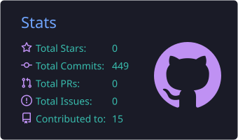
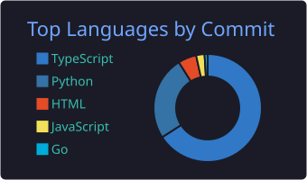
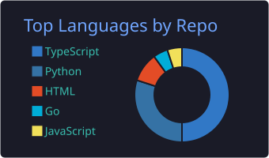
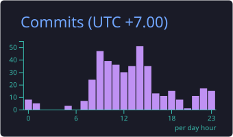

<!-- ───────────── HEADER ───────────── -->

<!-- ───────────── TYPING ───────────── -->

 

<i>When the plan works, I'm a <b>mastermind</b>. When it doesn't, it was a <b>prototype</b>, and I'm never the problem.</i>

  

<!-- ───────────── LINKS ───────────── -->

 

  

 

<!-- ───────────── TECH STACK ───────────── -->
<h3>⚡ Tech Stack</h3>

<b>LANGUAGES</b> 
  

<b>FRAMEWORKS &amp; LIBRARIES</b> 
  

<b>DATA &amp; TOOLING</b> 

  

 

<!-- ───────────── GITHUB STATS (self-generated by GitHub Action) ───────────── -->
<h3>📊 GitHub Stats</h3>

  
  

  
  

  

<!-- ───────────── FOOTER ───────────── -->

